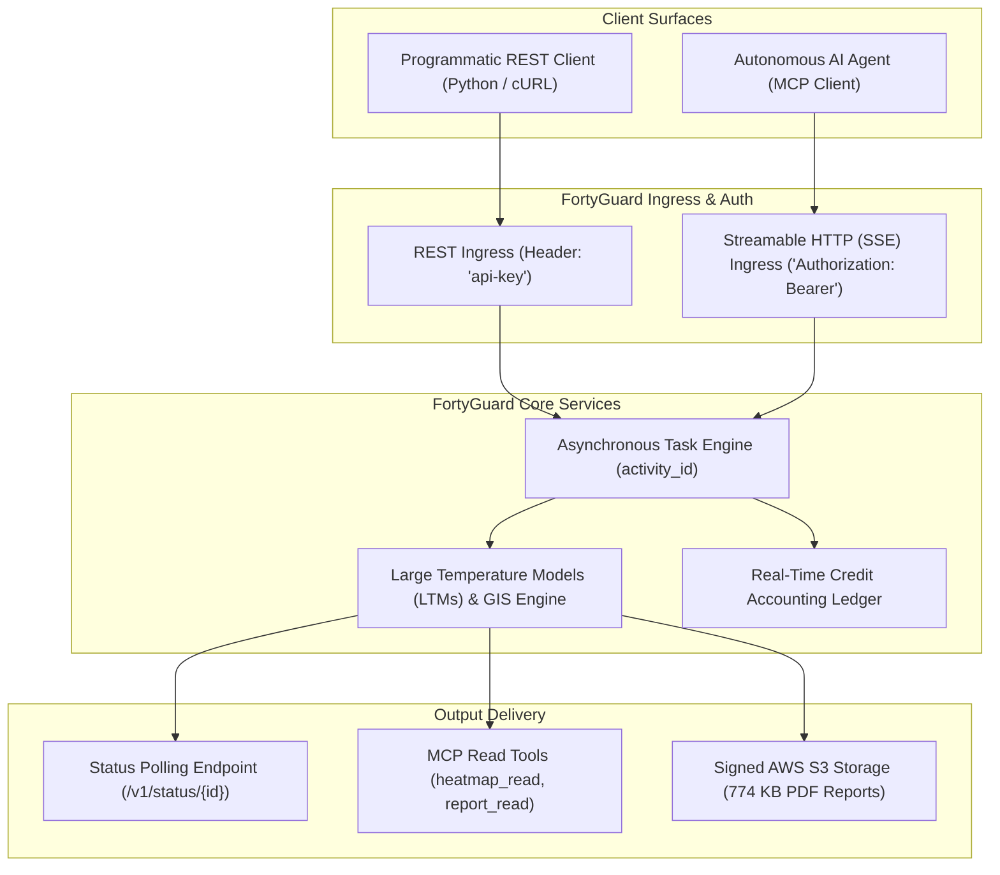

# FortyGuard Temperature API® & Model Context Protocol (MCP) — Engineering Evaluation Suite

**Applicant**: Hitesh Patil  
**Email**: hitesh.200711@gmail.com  
**Position Applied For**: Software Development Internship (January 2027 Cohort)  
**Products Tested**: FortyGuard Temperature API® (REST), FortyGuard Temperature MCP Server (`v4.0.11`)

---

## Overview

This repository contains an end-to-end automated test harness, forensic artifacts, cross-platform parity analysis, and technical evaluation deliverables for FortyGuard's **Temperature API®** and **Temperature MCP Server**.

The evaluation was executed as a production-grade validation suite: probing API contracts, asynchronous task queue lifecycles, schema enforcement, edge-case resilience, and credit ledger accounting.



---

## Executive Test Summary

| Metric | Result | Notes |
|---|---|---|
| **Account Plan Tier** | **Premium** | Valid through Nov 16, 2026 |
| **Credit Allocation** | 1,000,000 credits | Initial balance |
| **Credits Consumed** | 95,740 credits | **9.57%** total usage (well below safe budget) |
| **Remaining Balance** | 904,260 credits | Fair ledger accounting verified (0 credits for rejections) |
| **Test Pass Rate** | **30 / 30 (100%)** | Full lifecycle validation across 5 phases |
| **MCP Protocol** | Streamable HTTP (SSE) | Server `FortyGuard v4.0.11`, 11 live tools discovered |
| **Forensic PDF** | Verified & Downloaded | 774 KB forensic heat report retrieved via S3 pre-signed link |

---

### 1. Authentication Header Divergence
- **Current State**: REST requires `api-key: <KEY>`, while MCP strictly rejects it and mandates `Authorization: Bearer <KEY>`.
- **Proposed Solution**: Implement an authentication normalization middleware at the API Gateway allowing `Authorization: Bearer <KEY>` across both REST and MCP (RFC 6750 standard).

### 2. Temperature Unit Hazard
- **Current State**: `POST /v1/env_params` and `POST /v1/heatmap` strictly operate in **Celsius**. `POST /v1/heat_intelligence` requires input temperature in **Fahrenheit**.
- **Proposed Solution**: Introduce an optional `"unit": "celsius" | "fahrenheit"` field across all endpoints with default fallback to Celsius, or document explicit unit schemas in OpenAPI 3.1.

### 3. GeoJSON Wrapper Schema Discrepancy
- **Current State**: Documentation snippets in `create-heatmap.md` and `create-monitor.md` present bare `Polygon` geometries (`{"type": "Polygon", "coordinates": [...]}`). The backend strictly requires a GeoJSON `FeatureCollection` wrapper, rejecting bare polygons with `HTTP 422: "boundary_geojson must be a GeoJSON FeatureCollection."`
- **Proposed Solution**: Update documentation code samples to show the required `FeatureCollection` wrapper, or add a schema preprocessor on the backend that automatically coerces bare `Polygon` geometries into a single-feature `FeatureCollection`.

### 4. Live MCP Catalog Evolution
- **Current State**: Public documentation enumerates 9 tools. The live server exposes **11 tools**, having added `credit_balance` and `monitoring`.
- **Finding**: The additions are excellent for agentic use (allowing agents to check budget before calling expensive LTM tools). Public documentation should be updated to reflect these 2 additions.

### 5. Input Validation Error Boundaries
- **Current State**: Submitting non-ISO date formats (`07/15/2024`) returns an unhandled `HTTP 500 Internal Server Error`.
- **Proposed Solution**: Catch date parsing errors at the request schema validation layer (Pydantic / Joi) and return `HTTP 400 Bad Request` with an informative error message: `"Invalid date format. Expected YYYY-MM-DD or ISO 8601 string."`

---

## Repository Structure

```
├── README.md                           # This executive technical summary & architecture
├── fortyguard_evaluation_report.md     # Full comprehensive technical evaluation report
├── requirements.txt                    # Python runtime dependencies (requests, mcp)
├── .env.example                        # Template for configuring API credentials
├── .gitignore                          # Standard gitignore (protecting secrets and caches)
│
└── test-results/                       # Test suite outputs and forensic evidence
    ├── harness.py                      # Master automated test harness (Phases 1-5)
    ├── mcp_runner.py                   # Standalone Streamable HTTP MCP runner
    ├── heat_intelligence_report.pdf    # Validated 774 KB report downloaded from S3
    ├── test_log.jsonl                  # Timestamped structured test execution logs
    ├── test_summary.json               # Aggregated test execution metrics & pass rate
    ├── 1.1_credit_baseline.json        # Baseline credit check
    ├── 1.2_auth_valid.json             # Valid auth probe
    ├── 1.3_auth_invalid.json           # Invalid auth rejection (401)
    ├── 2.1a_env_params_result.json     # NYC environmental parameters response
    ├── 2.1b_env_params_filtered_result.json # Filtered analysis parameters
    ├── 2.2a_heatmap_result.json        # Phoenix 100m heatmap GeoJSON & stats
    ├── 2.3_satellite_result.json       # Chicago land-cover segmentation response
    ├── 2.4_streetview_result.json      # Streetview semantic segmentation masks
    ├── 2.5_heat_intelligence_result.json # S3 signed URL & metadata
    ├── 2.6_routing_result.json         # Temperature-optimized routing LineString
    ├── 2.7a_create_monitor.json        # Active threshold monitor creation
    ├── 2.7b_list_monitors.json         # List monitors response
    ├── 2.7c_get_monitor.json           # Monitor inspection
    ├── 2.7d_update_monitor.json        # Patch monitor configuration
    ├── 2.7e_list_alerts.json           # Monitor alert history query
    ├── 2.7f_delete_monitor.json        # Monitor cleanup response
    ├── 3.1_mcp_tools_discovered.json   # Full 11-tool JSON-RPC schemas
    ├── 3.2_mcp_credit_balance.json     # MCP credit_balance tool execution output
    ├── 3.3_mcp_env_params_result.json  # MCP env_params tool execution output
    ├── 3.8_mcp_auth_failure.json       # MCP invalid bearer token rejection
    ├── 4.1_cross_validation_parity.json # REST vs MCP parity matrix
    ├── 5.1_out_of_bounds.json          # Coverage rejection verification (OUT_OF_COVERAGE)
    ├── 5.2_invalid_date_format.json    # Date format robustness check
    ├── 5.3_missing_required_fields.json # Required schema enforcement (HTTP 422)
    ├── 5.4_routing_excessive_distance.json # Routing boundary check (>200 km)
    ├── 5.5_empty_aoi.json              # Empty polygon FeatureCollection rejection (HTTP 400)
    ├── 5.6_diagnostic_headers.json     # Server response header audit
    └── final_credits_usage.json        # Final post-test credit accounting audit
```

---

## How to Reproduce the Automated Tests

### 1. Prerequisites
- Python 3.10+
- FortyGuard API key configured in `.env`:
  ```bash
  cp .env.example .env
  # Add your FortyGuard API key: FORTYGUARD_API_KEY=your_key_here
  ```

### 2. Installation
```bash
pip install -r requirements.txt
```

### 3. Run the Test Harness
```bash
# Execute master REST & MCP validation suite
python test-results/harness.py

# Execute isolated MCP agent runner over Streamable HTTP
python test-results/mcp_runner.py
```

All responses, latencies, and credit consumption metrics will be output to `test-results/`.
